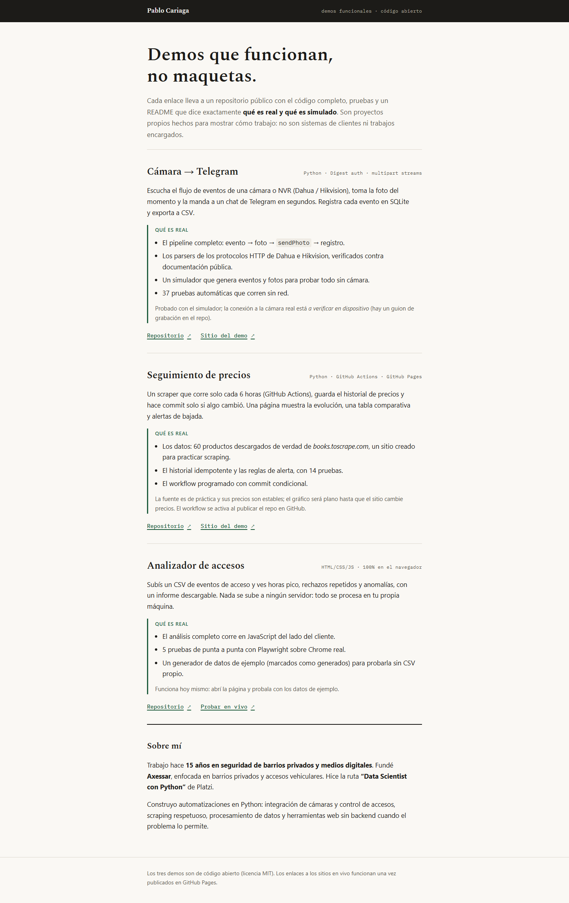
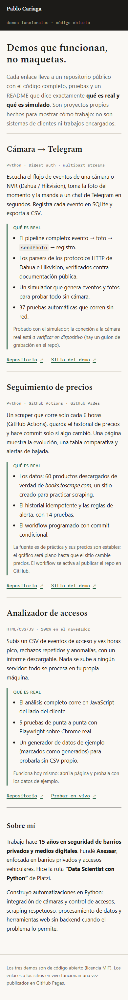

# Portafolio — página única

Página estática que enlaza los tres demos funcionales de Pablo Cariaga:

- **[camara-a-telegram](../camara-a-telegram)** — evento de cámara → foto en Telegram → registro.
- **[seguimiento-de-precios](../seguimiento-de-precios)** — scraper programado con GitHub Actions y sitio en Pages.
- **[analizador-de-accesos](../analizador-de-accesos)** — análisis de CSV de accesos 100% en el navegador.

Sin backend, sin dependencias de build: es HTML + CSS plano, listo para GitHub Pages.

## Capturas (reales)

Sitio publicado en GitHub Pages: https://esvindal.github.io/portafolio/




## Estado de publicación

Ya publicado bajo el usuario `Esvindal`. Los enlaces de `index.html` apuntan a
los repos y sitios reales.

## Qué es real y qué es simulado

| Elemento | Estado |
|---|---|
| Textos y descripciones de los demos | Reales: describen lo que cada repo hace y prueba |
| Resumen de Pablo | Real, provisto por él |
| Enlaces a repos/sitios | Funcionan al publicar; hoy llevan placeholder |
| Capturas de pantalla | No hay (la página se prueba con Playwright, ver `tests/`) |
| Testimonios, números de clientes, logos | No existen y no se inventan |

## Probar en local

```powershell
python -m http.server 8080
# abrir http://localhost:8080
```

## Tests

```powershell
python -m venv .venv
.\.venv\Scripts\pip install -r requirements-dev.txt
.\.venv\Scripts\python -m pytest tests/
```

Los tests usan Chrome instalado vía Playwright (`channel="chrome"`).

## Licencia

MIT — ver [LICENSE](LICENSE).
